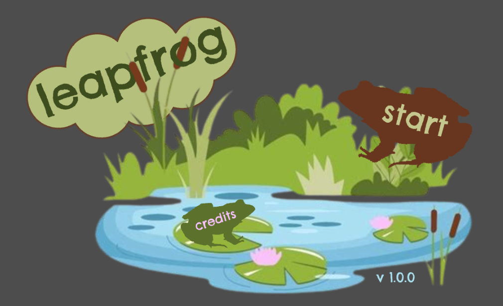

# leapfrog 3d

3d jumping game with a frog! made for Hack Club Stardance :)

currently it is a small demo hosted on github pages.. you can be the frog and jump around!

unfortunately i do not see myself having time to finish this anytime soon so it may stay like this forever :(

to play, go [here](https://how-does-this-work-again.github.io/leapfrog-3d/), or in the link under the about section of the repo!

after it loads, you should see a start screen like this:

then click start to play (or click the credits button for a fun animation i spent hours on)!

i would also like to clarify that this is a huge work in progress and lots of features (like getting to the main screen from the game screen..) are missing 😭

anyway hope you enjoy my silly little half-baked frog game :p

# controls

left arrow: turn left 90 degrees

right arrow: turn right 90 degrees

a: shift left

d: shift right

up arrow: jump

# credits
made with godot!

3d models: me (i am not a 3d designer i know it doesn't look amazing)

code: me

tutorials: i used a lot of tips and steps from [this tutorial](https://docs.godotengine.org/en/stable/getting_started/first_3d_game/index.html) found on the godot documentation site

ai use: i did not use ai to generate any code or art. i did use it to search a few things up and ask questions, but i usually followed the tutorials mentioned above.
